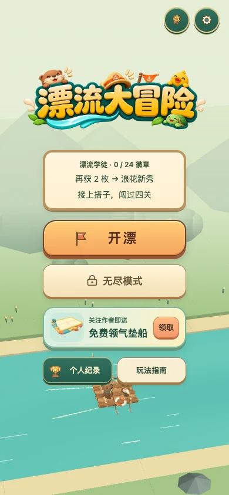
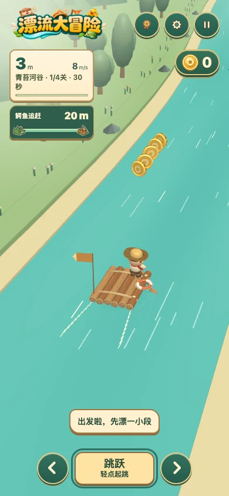
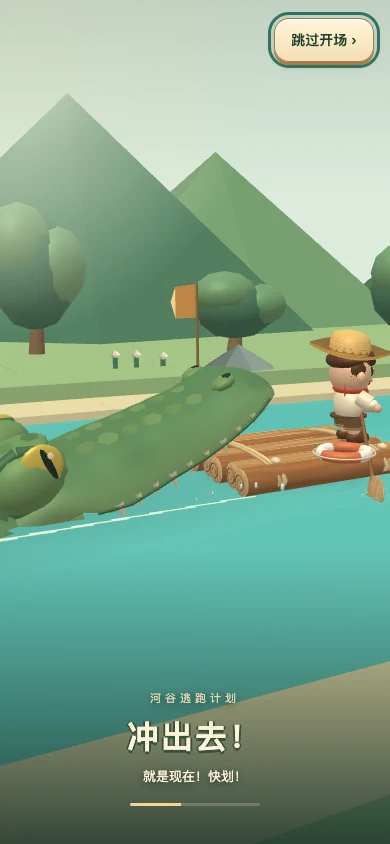

# 漂流大冒险 · 3D

一款原生 WebGL 漂流游戏。操控木筏在三条航道间换道、起跳，捡金币、接动物搭子，甩开身后的鳄鱼。穿过青苔河谷、红岩急流、失落遗迹和灯火营地，完成四关后解锁不断加速的无尽模式。

*River Adventure is a mobile-first 3D rafting game. Clear four timed stages to unlock endless mode.*

<p>
  
  
  
</p>

## 本地开玩

需要 Python 3 和支持 WebGL 的浏览器。在本目录启动静态服务：

```sh
python3 -m http.server 8000 --bind 127.0.0.1
```

打开 <http://127.0.0.1:8000/index.html>，点击「开漂」。不需要安装 npm 依赖、编译或启动后端。手机竖屏是主要游玩布局，桌面浏览器也支持键盘。

| 动作 | 触屏 | 键盘 |
| --- | --- | --- |
| 左右换道 | 在河面左右滑动，或点方向键 | ← / → 或 A / D |
| 起跳、空翻与扶正 | 点河面或操作按钮起跳，按住空翻；翻船后连点三次或按住扶正 | 空格或 ↑：轻按、按住或连续按 |
| 暂停 / 继续 | 右上角暂停按钮 /「继续漂流」 | P 或 Esc |

在「玩法指南」里可查看搭子、功能旗、冲浪和靠岸任务，也能单项练习。设置中可开启流畅画质或减少动态。普通浏览器会在本地保存记录，排行榜回退为个人纪录，关注福利需要原平台环境。详见[运行环境与存档](docs/PLATFORM.md)。

## 开发

```sh
node --test tests/*.test.mjs
```

使用 Node.js 22 运行测试，无需安装额外依赖。先看[开发与验证说明](docs/DEVELOPMENT.md)，界面或 3D 改动请参考[设计规范](docs/DESIGN.md)。提交问题或贡献改动时，可参考[贡献指南](CONTRIBUTING.md)。

## 授权与署名

项目代码、文档和自有美术素材采用 [MIT 许可证](LICENSE)。第三方素材沿用各自的原许可证，详见 [THIRD_PARTY_NOTICES.md](THIRD_PARTY_NOTICES.md)。
